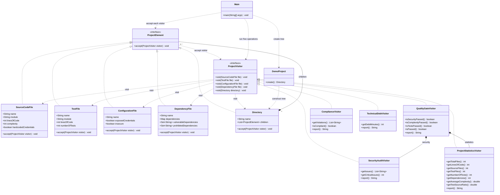
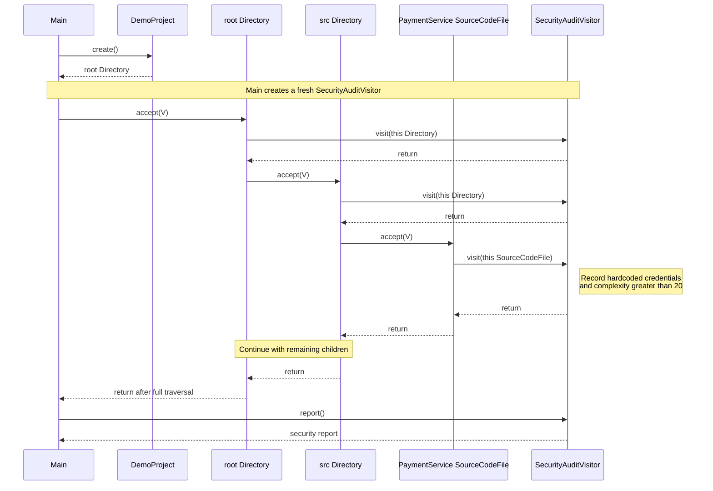

# UML diagrams

GitHub renders the Mermaid class and sequence diagrams below.

## Class diagram

Each concrete visitor implements all five `visit` overloads from `ProjectVisitor`;
they are omitted from the concrete boxes to keep the diagram readable.

## Sequence diagram

This shows the security traversal through the root and `src` directory to the first
source file in the demo. The remaining nodes follow the same `accept`/`visit` flow.

